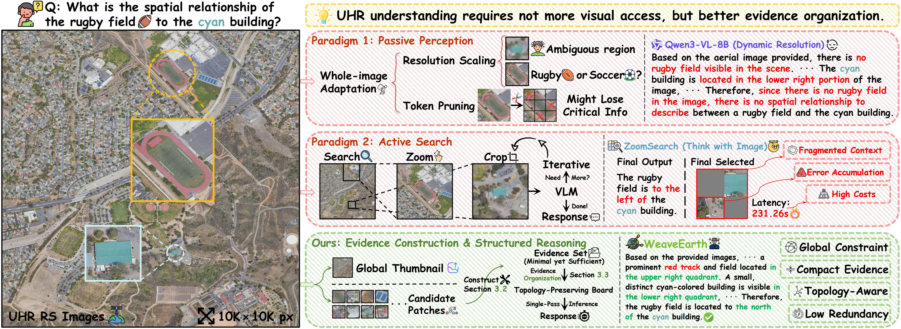

<h1 align="center">
  
  WeaveEarth: Structured Evidence Construction and Reasoning <br>
  for Training-Free UHR Remote Sensing Understanding
</h1>

<p align="center">
  Anonymous Author(s)
</p>

---


> **Abstract:** *Ultra-High-Resolution (UHR) remote sensing image understanding requires Vision-Language Models (VLMs) to capture both the global scene layout and sparse yet task-critical local details under limited computational budgets. Existing methods mainly follow two paradigms. One is passive perception, which relies on resolution expansion or token compression and may therefore discard fine-grained details. The other is active perception, which depends on multi-round zooming and search, but suffers from high latency, contextual fragmentation, and error accumulation. We argue that a more effective path toward UHR understanding lies not in accessing more, but in organizing better. To this end, we propose WeaveEarth, a training-free framework that reformulates UHR understanding as a problem of structured evidence construction and reasoning under global context constraints. Specifically, WeaveEarth first employs Global-Aware Evidence Construction to select a compact, low-redundancy, and spatially complementary Minimal Support Evidence Set. It then introduces Structured Evidence Reasoning, which weaves local evidence, spatial metadata, and relative topology into a unified reasoning interface, thereby enhancing the VLM's ability to perform global-local joint reasoning. Extensive experiments show that WeaveEarth consistently outperforms strong baselines and existing UHR methods across multiple UHR remote sensing benchmarks and multiple frozen VLM backbones.*

<p align="center">
  
</p>

<div align="center">


</div>

## 📑 Contents

- [🔥 News](#news)
- [🛠️ Setup](#setup)
- [💿 Benchmarks](#benchmarks)
- [🚀 Models](#models)
- [🏋 Evaluation](#evaluation)

---

<a id="news"></a>
## 🔥 News

- **[2026-04]**: ⏳ We have released the initial evaluation script for **Qwen3-VL** on the **LRS-VQA** benchmark.
- **[2026-04]**: 🧑‍💻 The anonymous project page is available.
- **[2026-04]**: 📦 The full codebase for all models and benchmarks will be made public immediately upon paper acceptance.

<a id="setup"></a>
## 🛠️ Setup

### Environment

- Python 3.11.11
- PyTorch 2.5.1
- NVIDIA A100 80GB GPU
- CUDA 12.4

### Installation

```bash
cd /WeaveEarth
conda create -n WeaveEarth python=3.11.11 -y
conda activate WeaveEarth
pip install torch==2.5.1 torchvision==0.20.1 torchaudio==2.5.1 --index-url https://download.pytorch.org/whl/cu124
pip install -r requirements.txt
```

<a id="benchmarks"></a>
## 💿 Benchmarks

We evaluate WeaveEarth on three representative UHR RS image understanding benchmarks. Please place the downloaded benchmarks in `/WeaveEarth/datars`.

| Benchmark | Description | Questions |
| :-- | :-- | :-- |
| [LRS-VQA](https://huggingface.co/datasets/ll-13/LRS-VQA) | Visual question answering dataset | 7,333 questions |
| [MME-RealWorld](https://huggingface.co/datasets/yifanzhang114/MME-RealWorld) | Multiple-choice benchmark | 3,738 questions |
| [XLRS-Bench](https://huggingface.co/datasets/initiacms/XLRS-Bench-lite) | Multiple-choice benchmark | 3,080 questions |

<a id="models"></a>
## 🚀 Models

Our method is a training-free framework that can be instantiated on representative open-source VLM backbones without any parameter fine-tuning. Please place the downloaded pre-trained weights in the `/WeaveEarth/ckpts` directory. In addition to the reasoning backbone, please also download the semantic retrieval encoder [`siglip2-so400m-patch16-naflex`](https://huggingface.co/google/siglip2-so400m-patch16-naflex-jax) and place it in the `/WeaveEarth/ckpts` directory.

| Backbone | Parameters | Paradigm | LRS-VQA (%) | MME-RealWorld (%) | XLRS-Bench (%) |
| :-- | :--: | :--: | --: | --: | --: |
| [Qwen3-VL](https://github.com/QwenLM/Qwen3-VL) | 8B | Training-Free | 33.38 | 47.38 | 47.14 |
| [LLaVA-v1.6](https://github.com/haotian-liu/llava) | 7B | Training-Free | 27.60 | 28.04 | 28.87 |
| [IXC-2.5](https://github.com/InternLM/InternLM-XComposer) | 7B | Training-Free | 32.58 | 39.96 | 34.37 |

<a id="evaluation"></a>
## 🏋 Evaluation
Please run the following command for evaluation:
```bash
python /WeaveEarth/inference_scripts/eval_lrs_vqa_qwen3vl.py   --reasoning_model_path /WeaveEarth/ckpts/Qwen3-VL-8B-Instruct   --dataset_jsonl_path /WeaveEarth/datars/LRS-VQA/LRS_VQA_merged.jsonl   --dataset_root /WeaveEarth/datars/LRS-VQA   --save_path /WeaveEarth/output/LRS-VQA-WeaveEarth
```
After evaluation, please check the specified `save_path` directory (e.g., `/WeaveEarth/output/LRS-VQA-WeaveEarth`) for the saved predictions and summary results.
